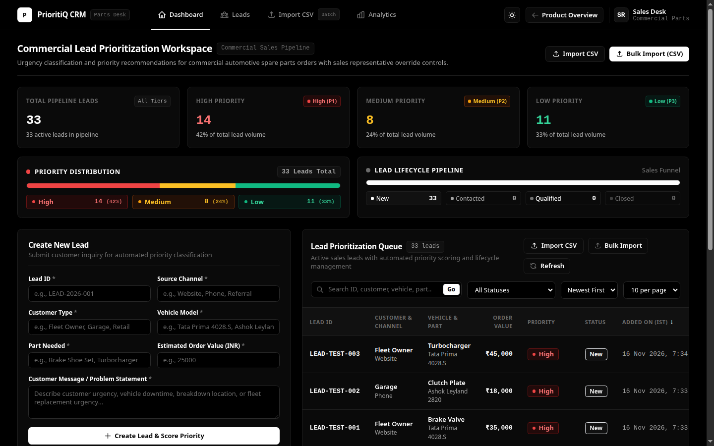
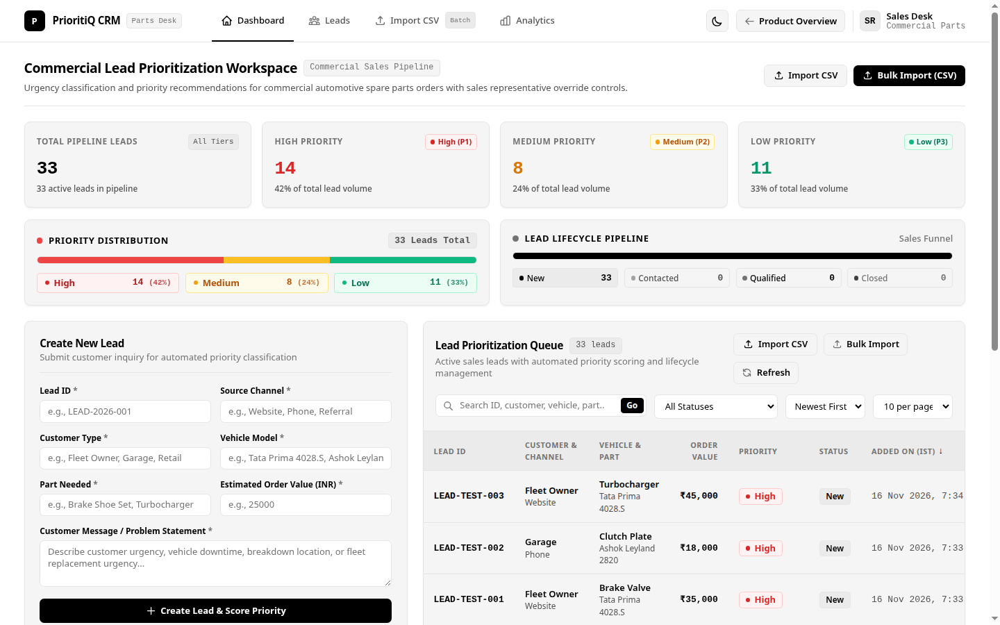
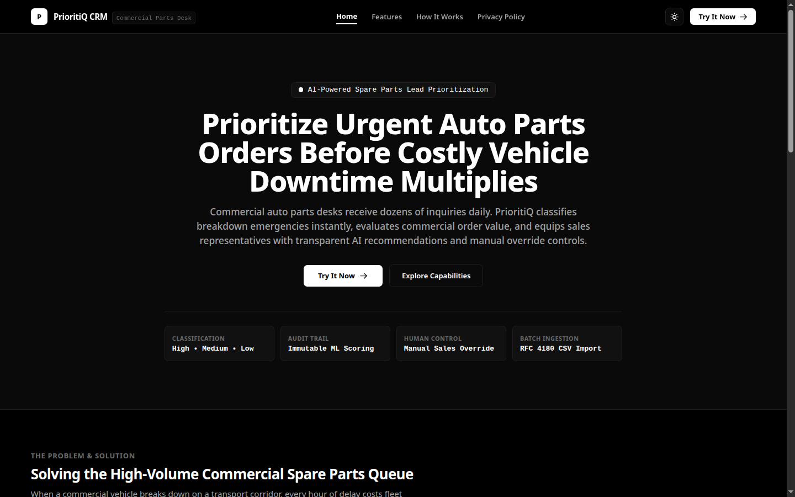
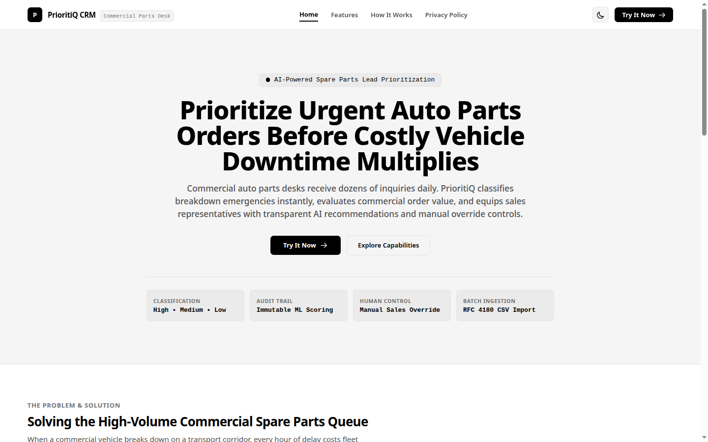

# PrioritiQ CRM — AI-Powered Commercial Spare Parts Lead Prioritization

[](https://www.python.org/)
[](https://fastapi.tiangolo.com/)
[](https://react.dev/)
[](https://vitejs.dev/)
[](https://tailwindcss.com/)
[](https://scikit-learn.org/)
[](https://pytest.org/)
[](LICENSE)

**PrioritiQ CRM** is an enterprise-grade AI-powered lead triage and sales prioritization platform designed specifically for commercial automotive spare parts dealerships, distributors, and fleet logistics desks.

When commercial trucks and fleet vehicles break down on transport corridors, every hour of unplanned downtime (**Vehicle Off Road - VOR**) incurs heavy financial losses. PrioritiQ uses a trained **Scikit-learn Natural Language Processing (NLP) classification pipeline** to parse incoming inquiries in real time, distinguish critical breakdown emergencies from planned maintenance and casual price checks, and empower sales representatives with transparent AI recommendations and human-in-the-loop overrides.

---

## Visual Preview

### Commercial CRM Workspace (Dark Mode & Light Mode)

| Dark Mode (Default) | Light Mode |
|:---:|:---:|
|  |  |

### Public Website & Showcase

| Dark Mode | Light Mode |
|:---:|:---:|
|  |  |

---

## Key Capabilities

### 1. AI-Powered Urgency Classification
- Inbound inquiries are scored in real time by a **TF-IDF + Multi-class Logistic Regression** model.
- Automatically classifies urgency into three tiers:
  - **High Priority (P1)**: Vehicle breakdown, immobilized on highway, express parts replacement needed immediately.
  - **Medium Priority (P2)**: Scheduled maintenance, weekend overhaul, preventative component replacement.
  - **Low Priority (P3)**: Bulk catalog restock, exploratory quotation inquiries.
- Calculates class posterior probabilities and assigns a calibrated **confidence score** (`0.0% – 100.0%`).
- **Immutable ML Audit Trail**: Model predictions and confidence scores are stored permanently in the database and cannot be altered, ensuring full compliance and algorithmic auditability.

### 2. Frontline Sales Management & Queue Optimization
- **Live Lead Queue Table**: High-density table featuring multi-field search (Lead ID, Customer Type, Vehicle Model, Part, Message), lifecycle filters, and configurable pagination.
- **Server-Generated IST Timestamps**: Tracks when each lead enters the CRM (`created_at`) displayed in readable Indian Standard Time (e.g. `15 Nov 2026, 1:30 PM`) with newest/oldest sorting.
- **Human-in-the-Loop Override Engine**: Sales reps can adjust the active `override_priority` for VIP or strategic accounts, instantly updating the `effective_priority` while preserving the original AI prediction.

### 3. High-Volume RFC 4180 CSV Ingestion
- Batch upload historical or external lead lists up to 10MB.
- Automated column header mapping, data type verification, and per-row error diagnostics.
- **Partial Acceptance Guarantee**: Valid rows are ingested, scored, and committed, while invalid rows are isolated with detailed failure reports.

### 4. Real-Time Pipeline Analytics
- Instant visibility into total pipeline volume, priority breakdown distribution bar, and 4-stage lifecycle conversion funnel (**New** → **Contacted** → **Qualified** → **Closed**).
- Zero reliance on slow batch reporting; metrics sync automatically after every action.

### 5. Professional Dark & Light Mode Design System
- Custom-engineered dual theme system with persistent state (`localStorage`), OS preference matching, and **zero Flash of Unstyled Theme (FOUC)** via synchronous initialization.
- Premium glassmorphic top navigation bar with accessible Sun/Moon theme toggling.

### 6. Public Product Website
- Fully featured public-facing website including **Home** (`/`), **Features** (`/features`), **How It Works** (`/how-it-works`), **Privacy Policy** (`/privacy`), and confirmation routing (`/thank-you`), seamlessly driving traffic to the CRM application (`/app`).

---

## Architecture & Technology Stack

```
┌────────────────────────────────────────────────────────────────────────┐
│                          PRIORITIQ ARCHITECTURE                        │
└────────────────────────────────────────────────────────────────────────┘

    [ Client Browser ]
           │
           ├─── Public Website Routes:  /, /features, /how-it-works, /privacy
           └─── Sales Workspace Route:  /app (CRM Dashboard)
           │
           ▼
┌──────────────────────────────────────┐
│  React 18 + Vite + Tailwind CSS      │  • SPA Client Router
│  (Frontend Single-Page App)          │  • ThemeContext (Dark/Light Mode)
└──────────────────┬───────────────────┘  • Axios/Fetch API Layer
                   │ HTTP REST (JSON)
                   ▼
┌──────────────────────────────────────┐
│  FastAPI (Python 3.10+)              │  • Pydantic v2 Input Validation
│  (Modular Backend Service)           │  • CORS Middleware (Multi-origin)
└──────────┬───────────────────────────┘  • Async Lifespan & Route Handlers
           │
           ├──► [ ML Inference Pipeline ]
           │    • Scikit-learn Logistic Regression
           │    • TF-IDF Vectorizer (Domain Vocabulary)
           │    • Sub-second latency (<15ms)
           │
           └──► [ Database Persistence Layer ]
                • SQLite / PostgreSQL via SQLAlchemy 2.0+
                • Persistent Schema with Automated Migrations
                • Server-generated UTC timestamps
```

### Stack Details
- **Frontend**: React 18, Vite 6, Tailwind CSS 3.4, PostCSS, Lucide Icons, Context API.
- **Backend**: FastAPI 0.110+, Uvicorn, Pydantic v2, Pydantic-Settings, Python-Multipart.
- **Data & ORM**: SQLite (default local) / PostgreSQL compatible, SQLAlchemy 2.0+.
- **Machine Learning**: Scikit-Learn 1.4+, Pandas 2.2+, NumPy 1.26+, Joblib.
- **Testing**: Pytest 8.1+, HTTPX (106 unit and integration test suite).

---

## Project Structure

```text
├── backend/
│   ├── app/
│   │   ├── main.py               # FastAPI app factory, CORS, and health endpoint
│   │   ├── database.py           # SQLAlchemy engine, session maker, and DB dependency
│   │   ├── models/               # SQLAlchemy ORM models (Lead entity)
│   │   ├── schemas/              # Pydantic validation schemas (LeadCreate, LeadResponse, etc.)
│   │   ├── routes/               # API route controllers (/leads, /metrics)
│   │   └── services/             # Business logic layer (ML inference, CSV parser, lead service)
│   ├── ml_models/
│   │   └── lead_priority_model.pkl # Pre-trained Scikit-learn TF-IDF + Logistic Regression model
│   ├── tests/                    # 106 automated tests (API, ML model, DB, CSV import, timestamps)
│   ├── requirements.txt          # Backend Python dependencies
│   └── README.md                 # Backend-specific documentation
├── frontend/
│   ├── src/
│   │   ├── components/
│   │   │   ├── common/           # Shared UI components (ThemeToggle, etc.)
│   │   │   ├── layout/           # App layout, Header, Top Navigation
│   │   │   ├── dashboard/        # DashboardShell, MetricsCards, LifecycleFunnel
│   │   │   ├── leads/            # LeadTable, LeadCreateForm, LeadDetailModal, CsvImportModal
│   │   │   ├── website/          # Public pages (HomePage, FeaturesPage, HowItWorksPage, PrivacyPage)
│   │   │   └── crm/              # CrmApp root controller
│   │   ├── context/              # ThemeContext (Dark/Light mode state & persistence)
│   │   ├── config/               # API URL resolution and environment helpers
│   │   ├── App.jsx               # Client-side router & title synchronization
│   │   └── index.css             # Tailwind directives and transition utilities
│   ├── index.html                # App shell with synchronous anti-FOUC theme script
│   ├── package.json              # Frontend scripts and npm dependencies
│   ├── tailwind.config.js        # Design system tokens and dark mode config
│   ├── vite.config.js            # Vite build configuration
│   └── vercel.json               # Vercel SPA routing and caching rules
├── screenshots/                  # High-resolution application screenshots
├── render.yaml                   # Render Blueprint for automated backend deployment
└── README.md                     # Root project documentation
```

---

## Getting Started Locally

### Prerequisites
- **Python**: 3.10, 3.11, or 3.12
- **Node.js**: 18.x or 20.x
- **Git**

---

### Step 1: Clone the Repository
```bash
git clone https://github.com/<your-username>/ai-lead-prioritization-crm.git
cd ai-lead-prioritization-crm
```

---

### Step 2: Set Up and Run Backend

```bash
cd backend

# Create and activate Python virtual environment
python3 -m venv venv
source venv/bin/activate       # On Linux/macOS
# .\venv\Scripts\activate      # On Windows

# Install dependencies
pip install --upgrade pip
pip install -r requirements.txt

# Start FastAPI development server
uvicorn app.main:app --reload --host 127.0.0.1 --port 8000
```

The backend is now live at:
- **API Base**: [http://127.0.0.1:8000](http://127.0.0.1:8000)
- **Interactive Swagger Docs**: [http://127.0.0.1:8000/docs](http://127.0.0.1:8000/docs)
- **ReDoc Documentation**: [http://127.0.0.1:8000/redoc](http://127.0.0.1:8000/redoc)
- **Health Check**: [http://127.0.0.1:8000/health](http://127.0.0.1:8000/health)

---

### Step 3: Set Up and Run Frontend

In a separate terminal window:

```bash
cd frontend

# Install Node dependencies
npm install

# Start Vite dev server
npm run dev
```

The frontend application is now running at [http://127.0.0.1:5173](http://127.0.0.1:5173).

---

## Running the Automated Test Suite

The backend includes a comprehensive automated test suite with **106 test cases** covering:
- Single lead ingestion and validation
- Scikit-learn inference and priority scoring
- Database constraints and uniqueness enforcement
- Timestamp generation and IST formatting
- Priority override retention and clearing
- CSV batch parsing, partial acceptance, and error isolation
- Pipeline analytics and aggregation queries

Run all tests:
```bash
cd backend
PYTHONPATH=. pytest tests/ -v
```

---

## API Reference Summary

| Method | Endpoint | Description |
| :--- | :--- | :--- |
| `GET` | `/health` | Service health status and version metadata. |
| `POST` | `/leads` | Create a lead, run ML classification, and persist record. |
| `GET` | `/leads` | Paginated query supporting search, status filters, and sorting. |
| `GET` | `/leads/{id}` | Retrieve individual lead by unique Lead ID. |
| `PATCH` | `/leads/{id}` | Update lifecycle status or apply/clear human priority override. |
| `POST` | `/leads/import` | Upload RFC 4180 CSV file for batch validation and automated scoring. |
| `GET` | `/metrics` | Real-time pipeline KPI metrics and priority distribution counts. |

---

## Deployment (Vercel + Render)

PrioritiQ includes ready-to-use production configuration files for zero-friction cloud deployment:

### 1. Backend on Render
The repository includes `render.yaml`.
1. Go to [Render Dashboard](https://dashboard.render.com/) → **Blueprints** → Connect your repository.
2. Render automatically builds the Python environment and executes `uvicorn app.main:app`.
3. Set environment variable: `CORS_ORIGINS=https://your-app.vercel.app`.

### 2. Frontend on Vercel
The repository includes `frontend/vercel.json`.
1. Go to [Vercel Dashboard](https://vercel.com/) → Import repository.
2. Set **Root Directory** to `frontend`.
3. Add Environment Variable:
   - `VITE_API_BASE_URL` = `https://your-render-backend.onrender.com`
4. Deploy!

For a full guide on handling cold starts and database configuration, refer to the [Vercel & Render Deployment Runbook](deployment_guide_vercel_render.md).

---

## Contributing & License

Contributions, bug reports, and feature requests are welcome! Feel free to open an issue or submit a pull request.

This project is licensed under the **MIT License**.
